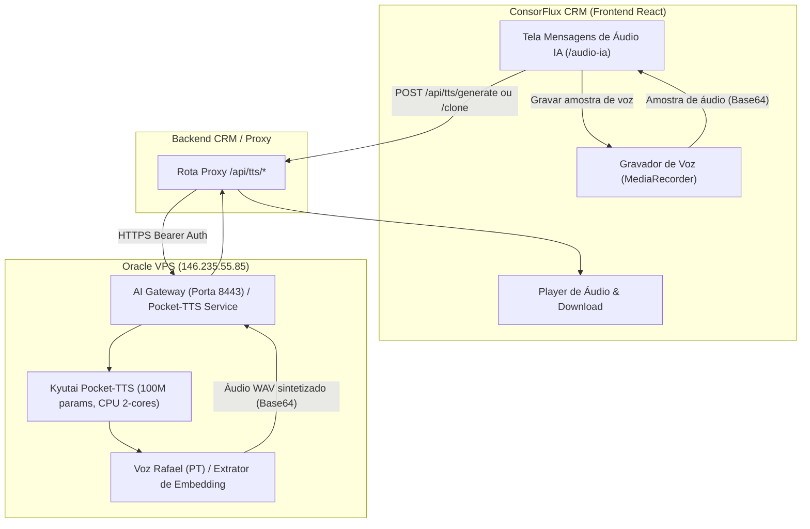

# Especificação Técnica: Implementação do Kyutai Pocket-TTS e Nova Tela no ConsorFlux CRM

## 1. Visão Geral e Objetivos

O objetivo deste projeto é integrar o modelo open-source **Kyutai Pocket-TTS** (https://github.com/kyutai-labs/pocket-tts) à infraestrutura do ConsorFlux CRM para geração de mensagens de voz e clonagem de voz do vendedor em português brasileiro.

### Objetivos Principais:
1. **Instalação e Configuração na VPS Oracle**:
   - VPS: 2 vCPUs, 12 GB RAM, IP `146.235.55.85` acessível via SSH.
   - Instalação otimizada CPU-only (sem bibliotecas CUDA desnecessárias).
   - Restrição estrita ao idioma **Português (PT)**, utilizando a voz pré-treinada **Rafael** e o mecanismo de clonagem de voz a partir de amostras de áudio.
2. **Serviço de Inferência**:
   - Microsserviço HTTP leve (FastAPI / Uvicorn ou AI Gateway) mantendo o modelo aquecido em memória RAM na VPS.
   - Proteção de concorrência com semáforo (respeitando o limite de 2 vCPUs).
3. **Nova Tela no CRM (`/audio-ia`)**:
   - Menu lateral em **Atendimento** com título **"Mensagens de Áudio IA"**.
   - Seleção de modo: **Voz Padrão (Rafael - PT)** vs **Minha Voz Clonada**.
   - Gravador nativo no navegador (HTML5 MediaRecorder API) para gravar a amostra de referência de voz do vendedor (ou upload de arquivo de áudio).
   - Área de texto para digitação da mensagem desejada em português.
   - Player de áudio com reprodução instantânea e download do arquivo gerado (WAV/MP3).
   - *(Fase 2 posterior: envio via WhatsApp com Evolution API após validação dos testes).*
4. **Documentação**:
   - Atualização completa do manual do sistema em `A11_CRM/README.md`.

---

## 2. Arquitetura do Sistema



---

## 3. Detalhamento dos Componentes

### 3.1. Infraestrutura na VPS (`146.235.55.85`)
- **Ambiente Virtual**: `/home/ubuntu/pocket_tts_env`
- **Dependências**:
  - `torch --extra-index-url https://download.pytorch.org/whl/cpu`
  - `pocket-tts`
  - `soundfile`, `scipy`, `fastapi`, `uvicorn`
- **Serviço HTTP (`/home/ubuntu/pocket_tts_service.py`)**:
  - Porta local: `8005` (ou integrado ao gateway `8443`).
  - Carregamento único do modelo:
    ```python
    from pocket_tts import TTSModel
    tts_model = TTSModel.load_model()
    ```
  - Endpoints:
    - `GET /health`: Diagnóstico de status e disponibilidade do modelo.
    - `POST /tts/generate`:
      - Payload: `{"text": "...", "voice": "rafael"}`
      - Retorno: `{"success": true, "audio_base64": "...", "duration": 3.2}`
    - `POST /tts/clone`:
      - Payload: `{"text": "...", "audio_base64": "..."}`
      - Retorno: `{"success": true, "audio_base64": "...", "duration": 4.1}`

### 3.2. Roteador no Backend do CRM (`backend-crm-cloudrun/app.py` ou serviço frontend)
- Adição dos endpoints `/api/tts/generate` e `/api/tts/clone` com autenticação de usuário Supabase.
- Encaminhamento com timeout configurado (máximo 60s) para o endpoint seguro da VPS.

### 3.3. Interface do Usuário (`A11_CRM/src/components/audio/AudioIAScreen.jsx`)
- **Seletor de Voz**:
  - Opção A: **Voz Padrão (Rafael - Português)**
  - Opção B: **Minha Voz Clonada**
- **Gravador de Microfone**:
  - Botão Iniciar Gravação / Parar Gravação / Descartar / Pré-escutar amostra.
  - Temporizador de gravação com recomendação de 5 a 10 segundos de fala natural.
- **Área de Texto**:
  - Textarea com contador de caracteres.
  - Modelos rápidos clicáveis para preenchimento ágil.
- **Player de Áudio**:
  - Controle de reprodução (Play, Pause, Barra de Progresso, Volume).
  - Botão para **Baixar Áudio (.wav)**.
- **Design Visual**:
  - Totalmente adaptado ao padrão Dark/Light do ConsorFlux CRM, com paleta em tons de azul índigo e esmeralda.

### 3.4. Navegação (`Sidebar.jsx` e `App.jsx`)
- Registro da rota `/audio-ia` no roteador do React (`App.jsx`).
- Adição do item no menu lateral sob a seção **Atendimento**:
  - Ícone: `Mic` (Lucide React)
  - Label: **"Mensagens de Áudio IA"**
  - Rota: `/audio-ia`

---

## 4. Tratamento de Erros e Casos de Borda

1. **VPS Indisponível ou Sobrecarga**:
   - Semáforo `threading.Semaphore(1)` na VPS para evitar picos de CPU com múltiplas requisições simultâneas.
   - Retorno de erro amigável (`503` ou mensagem de espera) caso a fila esteja cheia.
2. **Microfone Bloqueado no Navegador**:
   - Tratamento de exceção no `navigator.mediaDevices.getUserMedia` com aviso claro para o usuário permitir o microfone nas permissões do navegador.
3. **Texto Vazio ou Amostra Insuficiente**:
   - Validação antes do disparo: bloqueio do botão "Gerar Áudio" se o texto tiver menos de 3 caracteres ou se o modo clonado não possuir amostra gravada.

---

## 5. Plano de Testes e Validação

1. **Teste 1 (VPS - Instalação e CLI)**:
   - Verificar instalação do pacote `pocket-tts` no virtualenv.
   - Executar síntese de teste via CLI com voz `rafael` gerando arquivo local.
   - Executar teste de clonagem com arquivo WAV de referência.
2. **Teste 2 (VPS - Serviço HTTP)**:
   - Chamar endpoints `/tts/generate` e `/tts/clone` via `curl` e verificar retorno de áudio base64.
3. **Teste 3 (Frontend - UI e Gravação)**:
   - Gravar áudio no navegador e verificar captura correta do blob/base64.
   - Gerar áudio com a voz Rafael e reproduzir no player.
   - Gerar áudio com voz clonada e reproduzir no player.
4. **Teste 4 (Documentação)**:
   - Atualizar `A11_CRM/README.md` com a nova tela, fluxo de clonagem e especificações técnicas.
