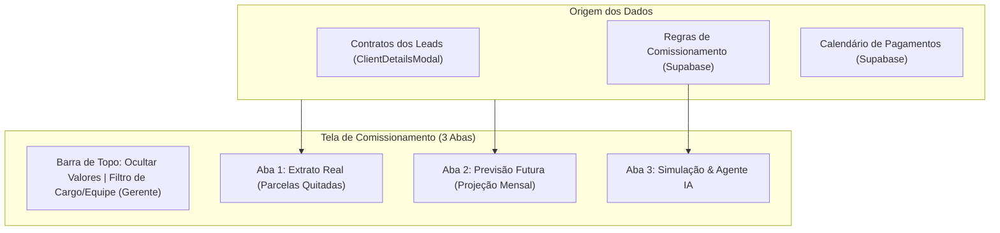

# Especificação Técnica: Sistema Enterprise de Regras e Extrato de Comissionamento

- **Data:** 14 de Outubro de 2026
- **Status:** Proposta Técnica para Aprovação
- **Aplicações:** `consorflux` (Frontend Vite/React) & `backend-crm-cloudrun` (Supabase Postgres & Cloud Run)
- **Autor:** Antigravity / Pair Programming com Consultoria GT Consórcios

---

## 1. Visão Geral e Arquitetura do Sistema

O objetivo deste projeto é reformular integralmente o ecossistema de **Comissionamento** do ConsorFlux, tornando-o um motor matemático e gerencial completo, adaptável a qualquer modelo de remuneração de administradoras e representantes autorizados de consórcio.

O sistema divide-se em dois pilares essenciais:
1. **Módulo Administrativo de Configuração de Regras e Calendário:**
   - Exclusivo para **Gerentes e Administradores**.
   - Integração com o catálogo oficial de tabelas (`simulador_tabelas`).
   - Construtor dinâmico de regras de comissionamento fracionado por parcela, bônus de adesão contratual e campanhas.
   - Calendário anual customizável com datas de pagamento, assembleias e critérios de liberação.
2. **Nova Tela de Comissionamento em 3 Abas:**
   - **Aba 1: Extrato Real:** Comissões confirmadas geradas por parcelas efetivamente quitadas pelo cliente no pós-venda.
   - **Aba 2: Previsão Futura:** Projeção mensal de recebíveis futuros com base na maturidade dos contratos ativos e parcelas vincendas.
   - **Aba 3: Simulação de Comissionamento & Agente de IA:** Simulador interativo de ganhos + agente analítico de IA que mapeia leads quentes do pipeline e projeta comissões alcançáveis.

---

## 2. Matriz de Perfis, Permissões e Ética Comercial

| Funcionalidade / Visão | Vendedor | Supervisor | Gerente / Administrador |
| :--- | :---: | :---: | :---: |
| **Extrato de Comissões Pessoais (Vendas Diretas)** |  Sim |  Apenas se liberado na regra |  Sim |
| **Extrato Consolidado da Equipe (Override)** | ❌ Não |  Sim (Montante acumulado da equipe) |  Sim |
| **Auditoria Individual do Extrato de Outro Vendedor** | ❌ Não | ❌ Não (Protegido por ética comercial) |  Sim (Filtro por vendedor/equipe) |
| **Configuração de Regras de Comissionamento** | ❌ Não | ❌ Não |  Sim (Aba restrita em Configurações) |
| **Calendário Anual de Pagamento e Assembleias** | 👁️ Somente leitura | 👁️ Somente leitura | ✏️ Edição completa |
| **Simulador de Comissionamento e Agente de IA** |  Sim |  Sim |  Sim |

---

## 3. Modelo de Dados no Supabase

### 3.1. Tabela `regras_comissionamento` (`commission_rules`)
```sql
CREATE TABLE IF NOT EXISTS public.regras_comissionamento (
    id UUID PRIMARY KEY DEFAULT gen_random_uuid(),
    tabela_id TEXT NOT NULL REFERENCES public.simulador_tabelas(id) ON DELETE CASCADE,
    tabela_nome TEXT NOT NULL,
    equipe TEXT NULL, -- NULL = regra geral da empresa; preenchido = regra de equipe específica
    ativo BOOLEAN NOT NULL DEFAULT true,
    
    -- Regras do Vendedor
    regras_vendedor JSONB NOT NULL DEFAULT '{
        "comissao_primeira_parcela_pct": 0.7,
        "bonus_adesao_contratual_pct": 0.0,
        "bonus_adesao_contratual_fixo": 0.0,
        "parcelas_recorrentes": [
            { "mes": 2, "pct": 0.25, "fixo": 0 },
            { "mes": 3, "pct": 0.25, "fixo": 0 },
            { "mes": 4, "pct": 0.30, "fixo": 0 }
        ],
        "bonus_campanhas": []
    }'::jsonb,
    
    -- Regras do Supervisor
    regras_supervisor JSONB NOT NULL DEFAULT '{
        "permite_venda_direta": false,
        "override_equipe_pct": 0.3,
        "parcelas_recorrentes": []
    }'::jsonb,

    -- Regras do Gerente
    regras_gerente JSONB NOT NULL DEFAULT '{
        "override_geral_pct": 0.15,
        "parcelas_recorrentes": []
    }'::jsonb,

    created_at TIMESTAMPTZ NOT NULL DEFAULT now(),
    updated_at TIMESTAMPTZ NOT NULL DEFAULT now(),
    updated_by UUID REFERENCES auth.users(id)
);
```

### 3.2. Tabela `calendario_comissionamento` (`commission_calendar`)
```sql
CREATE TABLE IF NOT EXISTS public.calendario_comissionamento (
    id UUID PRIMARY KEY DEFAULT gen_random_uuid(),
    ano INTEGER NOT NULL,
    mes INTEGER NOT NULL CHECK (mes >= 1 AND mes <= 12),
    dia_corte INTEGER NOT NULL DEFAULT 30,
    dia_pagamento INTEGER NOT NULL DEFAULT 5, -- 5º dia útil ou dia 5/10/15
    dia_assembleia INTEGER NULL,
    regra_liberacao TEXT NOT NULL DEFAULT 'apos_assembleia', -- 'apos_assembleia' | 'antes_assembleia' | 'producao_mes'
    descricao TEXT NULL,
    created_at TIMESTAMPTZ NOT NULL DEFAULT now(),
    updated_at TIMESTAMPTZ NOT NULL DEFAULT now(),
    UNIQUE (ano, mes)
);
```

---

## 4. Integração com o Modal de Detalhes do Lead (`ClientDetailsModal.jsx`)

Na aba **Acompanhamento (Pós-Venda)**, os contratos cadastrados receberão campos comerciais essenciais:
1. `tabela_id`: ID da tabela comercial utilizada (dropdown populado com `simulador_tabelas`).
2. `tabela_nome`: Nome amigável da tabela comercial.
3. `comAdesao`: Toggle/Checkbox "Venda com Adesão Contratual" (Sim/Não).
4. `comSeguro`: Toggle/Checkbox "Inclui Seguro Prestamista / Campanha".
5. `parcelasPagas`: Grade de booleanos já existente onde o vendedor assinala as parcelas quitadas pelo cliente.

### Gatilho de Cálculo Matemático:
* **Parcela 1 Paga:** Libera `comissao_primeira_parcela_pct * valorContrato` (+ bônus de adesão caso `comAdesao === true`).
* **Parcela $N$ Paga ($N \ge 2$):** Busca na regra da tabela se há comissão configurada para o mês $N$. Se houver, adiciona `pct_mes_N * valorContrato` ao lote do mês correspondente.

---

## 5. Arquitetura da Tela de Comissionamento (`ComissaoScreen.jsx`)



### Aba 1: Extrato Real
- **Cards de Métricas:**
  - *Comissão Liberada no Mês:* R$ recebíveis no próximo lote de pagamento confirmado.
  - *Comissão Acumulada no Ano:* Total já recebido em parcelas confirmadas.
  - *Contratos em Pagamento Ativo:* Quantidade de cotas ativas gerando receita.
- **Tabela / Cards de Parcelas Quitadas:**
  - Cliente | Cota/Grupo | Tabela Comercial | Parcela Quitada (ex: Parcela 1/180) | Data de Pagamento do Cliente | Valor da Comissão | Data Prevista de Depósito.

### Aba 2: Previsão Futura
- **Linha do Tempo e Cards Mensais:**
  - Visualização dos próximos meses (Outubro, Novembro, Dezembro, Janeiro...).
  - Gráfico comparativo de volume projetado.
  - Detalhamento de quais cotas estão previstas para pagar em cada mês caso mantenham adimplência.

### Aba 3: Simulação de Comissionamento & Agente de IA
- **Simulador Interativo:**
  - Seleção de tabela comercial (`simulador_tabelas`).
  - Input de valor do crédito (ex: R$ 100.000,00).
  - Checkbox "Com Adesão Contratual".
  - Projeção imediata de:
    - Valor na 1ª parcela (ex: R$ 700 + R$ 300 adesão = R$ 1.000).
    - Valor das parcelas recorrentes (Mês 2, Mês 3, Mês 4...).
    - Comissão total do contrato e percentual efetivo.
- **Agente de IA de Comissionamento:**
  - Leitura dos leads em "Negociação" e com alta pontuação de fechamento.
  - Card analítico com recomendações executivas e projeção de ganho imediato ao fechar cada cliente prioritário.

---

## 6. Nova Aba em Configurações: "Regras de Comissionamento"

Componente: `src/components/admin/ComissionamentoConfigTab.jsx`
- Acessível em `Configuracao.jsx` apenas para `isGerente || isAdmin`.
- **Bloco 1: Calendário Anual de Pagamentos:**
  - Matriz visual dos 12 meses do ano selecionado.
  - Edição de dia de corte, dia de pagamento e dia da assembleia.
- **Bloco 2: Gestor de Regras por Tabela:**
  - Seletor da tabela comercial (`t_auto_normal`, `t_imovel_normal`, etc.).
  - Configuração granular de percentuais e bônus para Vendedor, Supervisor e Gerente.
  - Botão de adicionar/remover meses de recorrência.
  - Botão de salvar no Supabase com feedback visual imediato.

---

## 7. Critérios de Validação e Verificação
1. **Verificação de Permissões:**
   - Logar como vendedor: só visualiza suas próprias cotas; aba de configuração em `Configuracao` permanece oculta.
   - Logar como supervisor: visualiza seu extrato consolidado de equipe (sem vendas diretas por padrão).
   - Logar como gerente/admin: visualiza filtros de auditoria de toda a equipe e aba de configuração completa.
2. **Cálculo Matemático:**
   - Contrato de R$ 100.000 em "Automóvel Normal":
     - Parcela 1 quitada -> R$ 700,00 no extrato real.
     - Com adesão marcada -> R$ 700,00 + bônus de adesão.
     - Parcela 2 quitada -> R$ 250,00 liberado.
3. **Previsão Futura:**
   - Mês seguinte lista as parcelas vincendas dos contratos ativos.
4. **Build e Testes:**
   - Compilação via `npm run build` sem erros de lint ou imports.
